# DZ60 keymap (caynan)

KBDFans DZ60 with a split space bar (2.25u / 1.25u / 2.75u), a split right Shift carrying the
Up arrow, a 2u Backspace, and an arrow cluster in the bottom-right corner. Uses
`LAYOUT_directional`; both halves of that layout's split Backspace are set to `KC_BSPC`, since
the 2u key sits on one of them.



`keymap.svg` is generated from `keymap.c`; see [Updating the image](#updating-the-image).
How to read it: a small label under a legend is what the key does when **held**. `▽` means the
key falls through to the layer below. A faint dashed key does nothing on that layer. The shaded
key on Fn and Nav is the one you hold to get there. Red keys reboot the board into its bootloader.

## Layers

| Layer | Hold | Contents |
|---|---|---|
| 0 Base | — | ANSI letters. Caps Lock position is `ALL_T(KC_ESC)`: tap for Esc, hold for Hyper (Ctrl+Shift+Opt+Cmd). Both Shifts are Space Cadet (`SC_LSPO` / `SC_RSPC`): tap for `(` and `)`, hold for Shift. The middle space key and the right-hand split Enter are `LT(2, …)`: tap for Space or Enter, hold for Nav. |
| 1 Fn | the key right of Up | `QK_BOOT` on Esc **and** on Backslash, `B` on Tab, everything from C onwards empty. |
| 2 Nav | middle space, or the split Enter | F1–F12 on the number row. Mouse on the left hand: `W A S D` move, `Q` / `E` left / right click, `R` / `F` wheel up / down. Arrows on `H J K L`, Print Screen on `P`. Media on the bottom-right: Play, Vol+, Mute above Prev, Vol-, Next. |

## How this was recovered

The original source was lost. The DZ60's ATmega32U4 runs Atmel's DFU bootloader, which sets
its security bit on every flash; `dfu-programmer read` then fails with `Memory read error`, and
only a chip erase clears the bit. So the keymap could not be dumped.

Instead it was captured from the outside with `tools/keymap-capture/capture.py`, which reads the
board's HID reports directly (keyboard, consumer/system and mouse interfaces), walks every key
position, and records what each one sends: once per layer while holding that layer's key. A
separate hold test (hold the key, tap J) exposed tap-hold behaviour that a single tap cannot
show. `tools/keymap-capture/build_keymap.py` turns the capture files into the layers in
`keymap.c`; every override it applies on top of the raw captures cites the evidence for it.

## What the capture cannot tell apart

- **Transparent vs. explicit.** A key on layer 1 or 2 that sent the same code as base is written
  as `_______`. The original may have repeated the base keycode explicitly, which behaves the same.
- **Empty vs. something invisible.** `KC_NO` means the key sent no HID report with the layer held.
  A key bound to a non-HID action (backlight, RGB, a layer toggle, EEPROM reset) would also send
  nothing. That applies to layer 1 from C onwards and to Z and X on layer 2. If one of them
  used to toggle the backlight or RGB, put the right keycode back.
- **Which reset.** Fn+Esc and Fn+Backslash each made the board drop off USB. Both are written as
  `QK_BOOT`; one of them may have been a different reboot-type key.
- **Timing.** Tapping term and other `config.h` options are back at QMK defaults. The old
  firmware's values are not observable.
- **USB IDs.** The old firmware enumerated as `FEED:2260`. Current QMK's dz60 uses `445A:2260`,
  which is what this keymap builds with.

## Building

From the userspace root, with `qmk config user.overlay_dir="$(pwd)"` set once:

```sh
qmk compile -kb dz60 -km caynan
```

CI builds the same target on every push to `main` and attaches `dz60_caynan.hex` to the
`latest` release.

## Flashing

> [!WARNING]
> Flashing erases the firmware on the board, and the old firmware cannot be backed up first
> (see above). Everything known about it is in `keymap.c`, minus the gaps listed under
> [What the capture cannot tell apart](#what-the-capture-cannot-tell-apart).

The DZ60 uses Atmel's DFU bootloader. `qmk flash` builds, waits for the bootloader, then writes:

```sh
qmk flash -kb dz60 -km caynan
```

When it prints `Bootloader not found ... Trying again in 5s`, put the board in bootloader
mode: hold Fn (right of Up) and press Esc. If the running firmware has no reset key, press the
reset button on the underside of the PCB. The board drops off USB, `dfu-programmer` erases and
writes it, and it restarts with the new keymap.

To flash the CI build instead of compiling locally:

```sh
gh release download latest --repo caynan/qmk_userspace --pattern dz60_caynan.hex
qmk flash dz60_caynan.hex                     # then Fn+Esc
```

Or by hand, with the board already in the bootloader:

```sh
dfu-programmer atmega32u4 erase --force
dfu-programmer atmega32u4 flash dz60_caynan.hex
dfu-programmer atmega32u4 launch
```

VIA is enabled (`rules.mk`). After this flash the VIA app can read the keymap and remap keys
live, but a change made in VIA lives only in the board's EEPROM. Copy it back into `keymap.c`,
or the next flash may drop it.

## Updating the image

After any change to `keymap.c`:

```sh
tools/draw-keymap/draw.sh            # rewrites keymap.svg
tools/draw-keymap/draw.sh --check    # what CI runs: exit 1 if keymap.svg is stale
```

The script runs [keymap-drawer](https://github.com/caksoylar/keymap-drawer) (pinned in the
script, run through `uvx`) on the output of `qmk c2json`. Legends are set in
`tools/draw-keymap/config.yaml`: a new keycode that renders as its raw name (for example
`RM_TOGG`) needs a `raw_binding_map` entry there. The script also merges the layout's split
Backspace into one 2u key, to match this board. Update the Layers table above in the same
commit.

The `Keymap image` workflow fails any push where `keymap.svg` does not match `keymap.c`.
